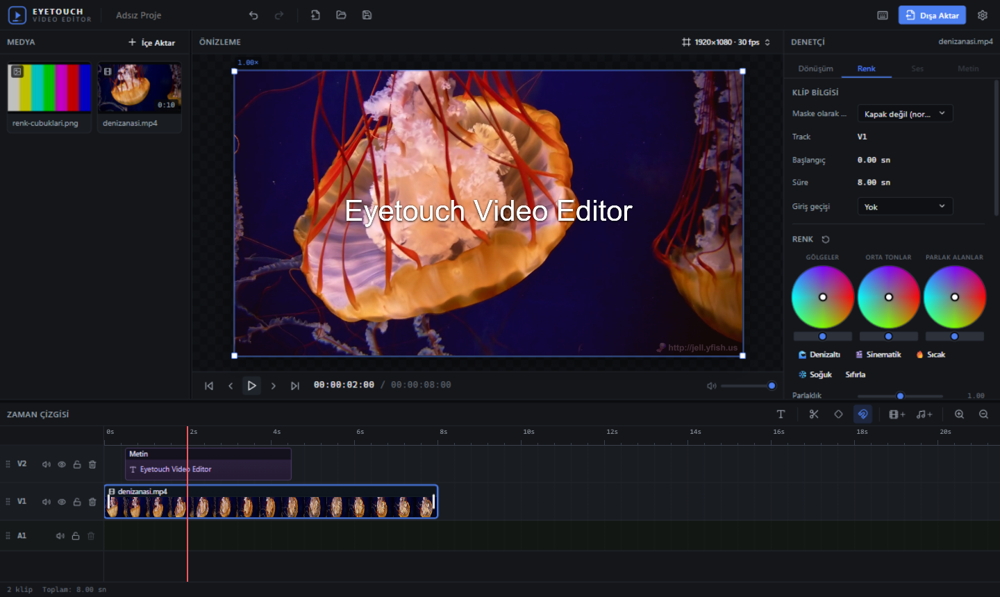
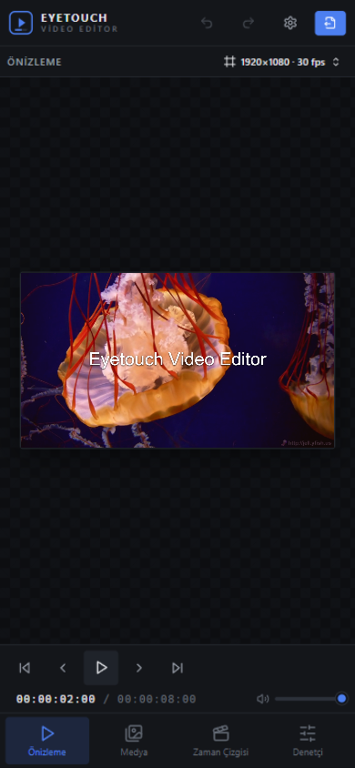

# Eyetouch Video Editor



Telefon/tablet:



**Sürüm 1.0.0** · Windows · [GitHub](https://github.com/aytackayin)

Tarayıcıda çalışan, **tamamen yerel** ve ücretsiz video düzenleyici. Medyalarınız hiçbir sunucuya yüklenmez — kırpma, hızlandırma, keyframe animasyonları, yeşil perde, LUT, maskeleme ve dışa aktarma dahil her şey cihazınızda gerçekleşir.

A **fully local, free, in-browser video editor**. Your media never leaves your device — trimming, retiming, keyframes, chroma key, LUTs, masking and exporting all run locally.

---

## Özellikler / Features

- 🎞 **Zaman çizgisi**: çoklu video/ses track'leri, sürükle-bırak, mıknatıs (snap), imleç/kenar hizalama, track sürükleyerek sıralama
- ✂️ Klipleri imleçten bölme (S / makas), **Alt+sürükle** veya **Ctrl+D** ile çoğaltma, kenardan sürükleyerek hızlandırma/yavaşlatma (retime)
- 🖌 **Dönüşüm**: önizlemede taşıma/ölçekleme/döndürme (köşe dışı döndürme bölgeleri), canvas ve diğer kliplere mıknatıslama
- 🎭 **Maskeleme**: dikdörtgen, elips, **PNG görsel** ve **animasyonlu video** maskeleri — kural: maskenin **siyah** bölgeleri klibi gösterir, beyaz/şeffaf gizler
- 🌈 Renk düzenleme (parlaklık, kontrast, gama, doygunluk, ton, pozlama, sıcaklık, netleştirme, blur, pus giderme), **yeşil perde**, **.cube LUT**
- 🔑 **Keyframe** animasyonları (konum, ölçek, dönme, opaklık, ses)
- 🔊 Ses: dalga formu, fade in/out, gürültü azaltma, sesi ayırma
- 📦 **Paketli .evproj**: proje dosyası kullanılan tüm medyayı içine gömer — orijinal dosyalar silinse bile proje tam geri yüklenir
- 🎬 Dışa aktarma: MP4, MOV, WebM, MKV, GIF + dönüşüm formatları (AVI, FLV, WMV, TS) ve salt-ses formatları (MP3, WAV, OGG, FLAC, M4A)
- 🌙 Açık/Koyu/Sistem teması, Türkçe/İngilizce arayüz, sağ tık menüleri, klavye kısayolları
- 💾 Her şey otomatik kaydedilir (IndexedDB) — sekmeyi kapatsanız bile

## Uzaktan erişim (Tailscale) / Remote access

Sistem tepsi menüsündeki **Uzaktan erişim (Tailscale/Ağ)** anahtarını açın; balonda Tailscale adresi görünür (ör. ). Aynı tailnet'teki herhangi bir cihazın tarayıcısından bu adresi açarak uygulamayı kullanabilirsiniz. İlk açışta Windows Güvenlik Duvarı izni isteyebilir — **İzin ver** deyin.

Enable **Remote access (Tailscale/LAN)** in the tray menu; the balloon shows your Tailscale URL (e.g. ). Open it from any device on your tailnet. Allow access if Windows Firewall asks on first connect.

> Not: Projeler ve medya her tarayıcının kendi yerel deposunda tutulur — uzaktaki cihaz kendi ayrı çalışma alanını görür. Cihazlar arasında proje taşımak için  kaydet/aç kullanın.

## Kurulum / Install

### Kullanıcılar için (Windows)

1. `Eyetouch.exe` dosyasını çalıştırın.
2. Uygulama **sistem tepsisinde** ikon olarak bekler, sunucuyu arka planda (gizli) başlatır ve tarayıcıda açar.
3. Tepsi menüsü: **Çalıştır / Yeniden Başlat / Güncelle / Dil (TR-EN) / Çık**.
   - İki kopyanın aynı anda çalışması engellenir.
   - **Güncelle**: GitHub'daki son sürümü indirip kurar (release yoksa bildirir).

### Geliştiriciler için

```bash
git clone https://github.com/aytackayin/EyetouchVideoEditor.git
cd EyetouchVideoEditor
npm install
node make-bundle.cjs     # appsrc/ → tek main.tsx
npm run build            # dist/ üretimi
node server.cjs          # http://127.0.0.1:5173
```

Geliştirme sunucusu: `npx vite` · Tepsi EXE'si: `build-tray.bat` (yerleşik .NET csc ile derler, kurulum gerektirmez).

## Kısayollar / Shortcuts

| Kısayol | İşlev |
|---|---|
| Boşluk | Oynat / duraklat |
| J / K / L | Geri sar / dur / ileri (L hızlanır) |
| S | Seçili klibi imleçten böl |
| Alt + Sürükle / Ctrl+D | Klibi çoğalt |
| Alt + Tekerlek | Zaman çizgisi zoom |
| Shift + Tekerlek | Zaman çizgisinde yatay kaydırma |
| Tekerlek | Dikey kaydırma |
| M | İşaret (marker) ekle |
| T | Metin klibi ekle |
| Ctrl+Z / Ctrl+Shift+Z | Geri al / yinele |
| Del | Seçili klipleri sil |
| ← / → | Kare kare ileri-geri |
| Home / End | Başa / sona sar |

## Proje yapısı

```
appsrc/           Uygulama kaynak kodu (TypeScript modülleri)
  components/     Arayüz bileşenleri
  engine/         Render (WebGL2) ve oynatma motoru
  state/          Zustand depoları (proje, medya, arayüz)
  media/          İçe aktarma, depolama, .evproj paketi
  i18n/           Türkçe / İngilizce
make-bundle.cjs   Tüm modülleri tek main.tsx'e birleştirir
server.cjs        Bağımlılıksız üretim sunucusu (dist/)
tools/EyetouchTray.cs  Sistem tepsi başlatıcısı (C#)
dist/             Derlenmiş uygulama
```

## Lisans / License

[MIT](LICENSE) © [aytackayin](https://github.com/aytackayin)
